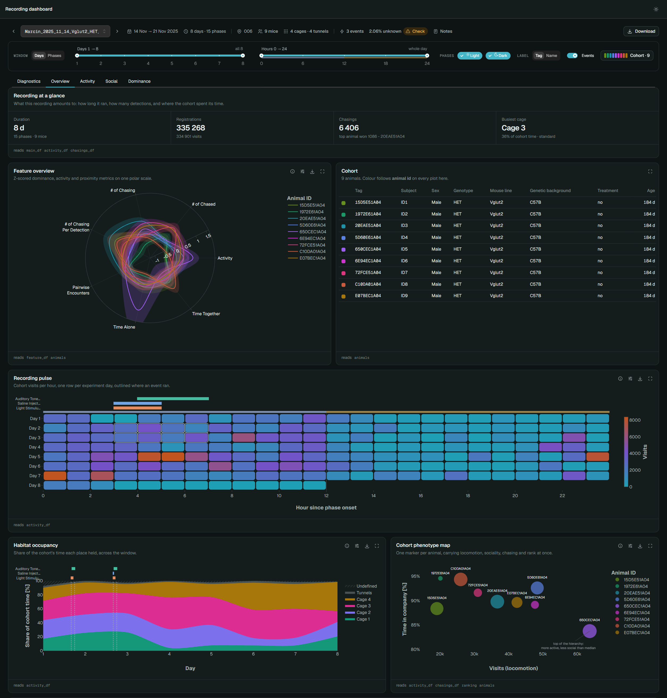

# DeepEcoHab: fast and intuitive data analysis platform for your EcoHab experiments

[](https://pypi.org/project/deepecohab/)
[](https://pypi.org/project/deepecohab/)
[](https://github.com/DeepEcoHab/DeepEcoHab/blob/main/LICENSE)
[](https://deepecohab.github.io/DeepEcoHab/)

DeepEcoHab is an analytics platform built for preprocessing, analysis and visualization of data acquired in the DeepEcoHab.

Our backend is built on [Polars](https://pola.rs/) - Extremely fast Query Engine for DataFrames, written in Rust and visualization utilizes [Plotly](https://plotly.com/), providing interactive, high quality and responsive plots of experiments regardless of their length.

📖 **[Read the full documentation](https://deepecohab.github.io/DeepEcoHab/)** — installation, the app walkthrough with screenshots and videos, the analysis tables and every plot.



## Quick start

Two steps get you from nothing to a running dashboard:

```
uv tool install "deepecohab[app]"   # install as a standalone app
deepecohab-shortcut                 # create a desktop icon
```

Then double-click the **DeepEcoHab** icon on your desktop. See
[Installation](#installation) for `uv` setup and other platforms.

## Installation

We keep DeepEcoHab lean to ensure easy integration and fast installation. We build on [uv](https://docs.astral.sh/uv/) — a fast,
self-contained Python package manager.

### Step 1 — Install `uv`

**Windows:**
```
powershell -ExecutionPolicy ByPass -c "irm https://astral.sh/uv/install.ps1 | iex"
```

**Linux / macOS:**
```
curl -LsSf https://astral.sh/uv/install.sh | sh
```

### Step 2 — Install DeepEcoHab

For most users the simplest path is to install DeepEcoHab as a standalone
application. This puts the `deepecohab-app` and `deepecohab-shortcut` commands
on your PATH in an isolated environment — no virtual environment to create or
activate:

```
uv tool install "deepecohab[app]"
```

That's it. Run `deepecohab-app` to launch the dashboard, which opens automatically
in your browser.

> If the commands aren't found afterwards, run `uv tool update-shell` and reopen
> your terminal.

### Desktop shortcut (Windows)

After `uv tool install "deepecohab[app]"`, create a clickable desktop icon with:

```
deepecohab-shortcut
```

This places a **DeepEcoHab** shortcut on your desktop. Double-clicking it starts
the dashboard and opens it in your browser — no terminal required. This is the
recommended way to launch DeepEcoHab for most users.

### Updating

The app tells you when it starts if a newer version is out; **Update now** installs it and
reopens the app. To update by hand instead, close the app and run:

```
uv tool upgrade --python 3.15 "deepecohab[app]"
```

### Working from code instead

The app is an extra because the analysis itself does not need Dash. If you only want the
library, install it with the notebook extra, which adds the Jupyter kernel and what
`figure.show()` needs inside a notebook (plain scripts can drop `[notebook]`):

```
uv pip install "deepecohab[notebook]"
```

We recommend [VSCode](https://code.visualstudio.com/download) with the Jupyter
extension to run the example notebooks provided in the repository.

To install from source:

```
cd location_to_clone_to
git clone https://github.com/DeepEcoHab/DeepEcoHab.git
cd DeepEcoHab
pip install ".[app]"
```

## Example data

[`examples/data`](./examples/data) ships six real recordings, each a `<name>.config.json` beside its
`<name>.data.parquet`. [`example_notebook.ipynb`](./examples/example_notebook.ipynb)
runs them end to end: create a project, add every recording, tune the analysis parameters, run
the pipeline and aggregate a project table.

## Data structure:

The data is stored in parquet format - an open-source, column-oriented data storage format which allows extremely fast read/write operations of large dataframes. Every recording in a project keeps one parquet file per analysis table, loaded with `recording.load_results(key)`.

To get the list of available keys call `deepecohab.core.data_model.DataFrameRegistry.list_available()`; similarly `deepecohab.PlotRegistry.list_available()` lists the available visualizations. See the [antenna analysis guide](./docs/tutorial_antenna.md) and [plotting guide](./docs/plotting.md).

## Roadmap

1. A docker container for running the app on a shared server.
2. Group analysis - combined analysis of multiple cohort, comparing different groups of cohorts.
3. Pose estimation based analysis of animal interactions and more detailed social structure analysis.

## DeepEcoHab team

DeepEcoHab is developed at Ewelina Knapska's Laboratory of Emotions Neurobiology,
Nencki Institute of Experimental Biology, Polish Academy of Sciences, Warsaw:

- **Konrad Danielewski** ([@KonradDanielewski](https://github.com/KonradDanielewski)) - lead developer and maintainer
- **Ula Włodkowska** ([@uwlodkowska](https://github.com/uwlodkowska))
- **Marcin Lipiec** - principal investigator
- **Ewelina Knapska** - head of the laboratory

With contributions from [@Winiarsky](https://github.com/Winiarsky) and
[@Brosnan-neuro](https://github.com/Brosnan-neuro).

Found a bug or missing a feature? Open an issue
[here](https://github.com/DeepEcoHab/DeepEcoHab/issues).

## Citations

DeepEcoHab has no paper of its own yet. If you use it in published work, please cite the
package together with the paper introducing the Eco-HAB system:

```bibtex
@software{deepecohab,
  title     = {{DeepEcoHab}: fast and intuitive data analysis platform for {EcoHab} experiments},
  author    = {Danielewski, Konrad and W{\l}odkowska, Ula and Lipiec, Marcin and Knapska, Ewelina},
  year      = {2026},
  publisher = {GitHub},
  url       = {https://github.com/DeepEcoHab/DeepEcoHab}
}

@article{puscian2016ecohab,
  title   = {Eco-{HAB} as a fully automated and ecologically relevant assessment of social impairments in mouse models of autism},
  author  = {Pu{\'s}cian, Alicja and {\L}{\k e}ski, Szymon and Kasprowicz, Grzegorz and Winiarski, Maciej and Borowska, Joanna and Nikolaev, Tomasz and Boguszewski, Pawe{\l} M. and Lipp, Hans-Peter and Knapska, Ewelina},
  journal = {eLife},
  volume  = {5},
  pages   = {e19532},
  year    = {2016},
  doi     = {10.7554/eLife.19532}
}
```
