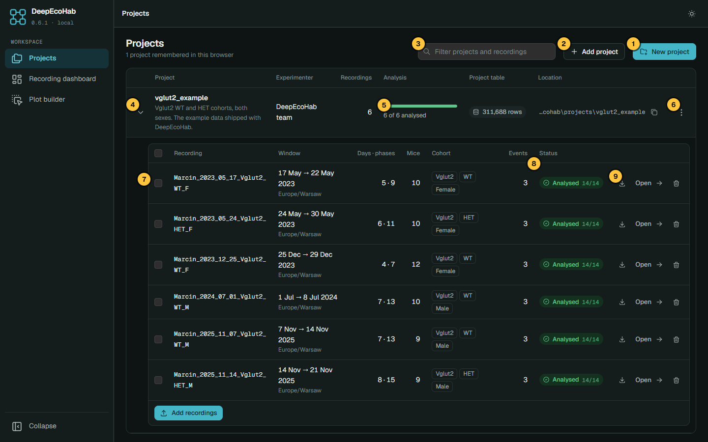
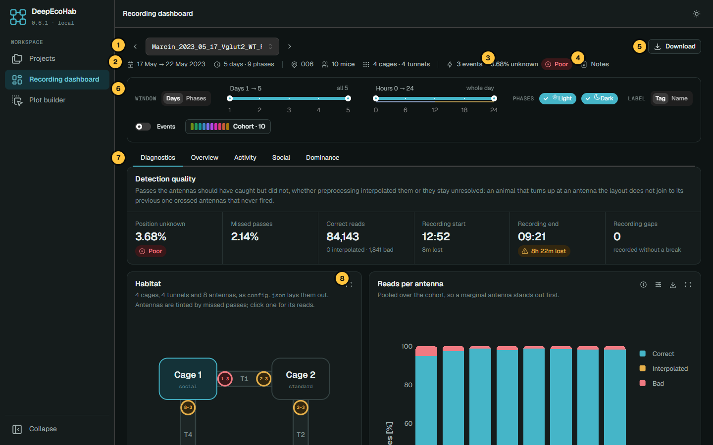
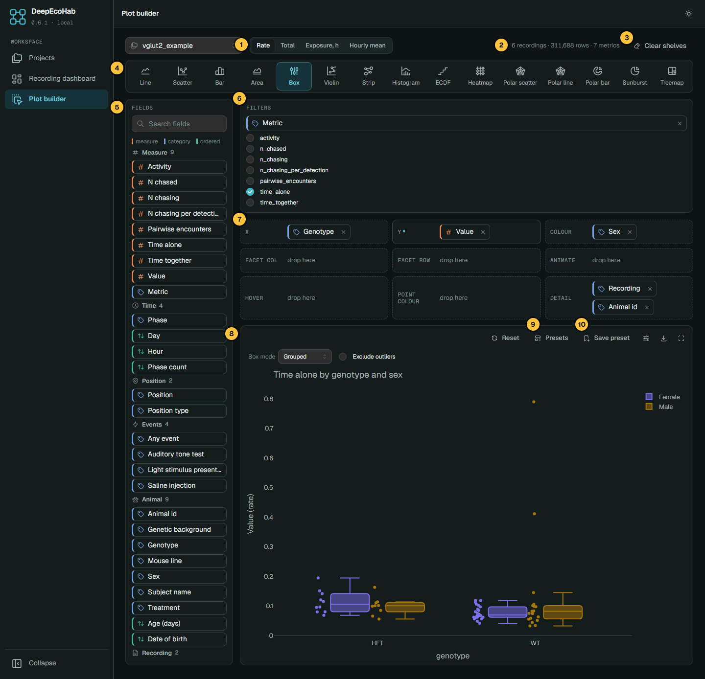

The app runs the whole pipeline in your browser, on your own computer. Each section below
starts with a short video; the steps underneath cover the same ground. To follow along, use
the six example recordings in
[`examples/data`](https://github.com/DeepEcoHab/DeepEcoHab/tree/main/examples/data).

## Start the app

Double-click the **DeepEcoHab** desktop icon (see [Install](index.md#install)), or run
`deepecohab-app`. The app opens at `http://127.0.0.1:8050`.

:::{dropdown} Command-line options and logs
| option | effect |
|---|---|
| `--port 8060` | serve on another port |
| `--host 0.0.0.0` | accept connections from other computers on your network |
| `--no-browser` | do not open a browser tab |
| `--debug` | print warnings and errors in the terminal |

Without `--debug`, warnings and errors go to `~/.deepecohab/app-cache/app.log`; attach it
when you report a problem. Stop the app with `Ctrl+C` in its terminal.
:::

The sidebar leads to **Projects**, **Recording dashboard** and **Plot builder**. The button in
the top right switches between the dark and light theme.

## Create a project and add recordings

:::{anywidget} player.mjs
{"src": "videos/create-project.mp4", "title": "Create a project and add recordings"}
:::

1. **New project** → fill in **Project name** and **Experimenter** → **Create project**. An
   empty **Folder** puts it in `Documents/deepecohab/projects`.
2. Open the project's row and click **Add recordings**.
3. Drop the files of as many recordings as you like. Each recording is three files sharing a
   name: `<name>.config.json`, `<name>.data.parquet` and `<name>.diagnostic.json` (see
   [Input files](data.md#input-files)).

The files are copied into the project. A recording that fails to validate is listed under
**Not added** with the reason; the others go in. A name already in the project asks whether to
**Replace** it, which discards its results, or **Skip** it.

**Add project** opens a project that already exists on disk: give the folder holding
`project.json`. The project list lives in this browser only; removing a project from it never
touches its files.

## Run the analysis

:::{anywidget} player.mjs
{"src": "videos/run-analysis.mp4", "title": "Run the analysis"}
:::

1. Tick the recordings to analyse. A bar appears at the bottom of the page.
2. Optionally, open **Parameters** to change the thresholds (see
   [Analysis parameters](data.md#analysis-parameters)).
3. Click **Run analysis**.

Only missing tables are built. Turn on **Overwrite existing tables** to rebuild everything,
for example after changing a parameter. Each recording then reads **Analysed**, **Partial**
(run again to finish), **Not analysed** or **Failed** (hover the badge for the error).

:::{dropdown} The project menu (⋮) and recording actions
| action | what it does |
|---|---|
| Open in plot builder | opens the [plot builder](#plot-builder) on this project |
| Generate project table | pools every analysed recording into `project_table.parquet`, which the plot builder reads; the **Project table** badge says when it is out of date |
| Download | the project table as Parquet or CSV, or the whole project as a zip |
| Copy path | copies the project folder's path |
| Remove from list | forgets the project in this browser; its files stay |

In a recording's row, the download button gives its tables, cohort, config or raw data, and
the bin button removes it. **Delist, keep files** can be undone with **Reinstate**; **Delete
files** cannot.
:::

## Recording dashboard

**Open**, in a recording's row, shows that recording: first whether its data can be trusted,
then what the animals did.

:::{anywidget} player.mjs
{"src": "videos/dashboard.mp4", "title": "The recording dashboard"}
:::

The **control bar** at the top filters every plot on the page:

| control | what it does |
|---|---|
| Window | count the recording in days or in phases, and narrow to a stretch of them; click a slider handle to type an exact value |
| Hours | narrow to part of the day, counted from the onset of the first phase |
| Phases | keep the light phase, the dark phase or both |
| Label | name animals by their tag or their name |
| Animals by | colour animals by tag, or by a cohort attribute such as genotype |
| Group mean | one line per group instead of per animal |
| Events | show or hide the event lanes and marks |
| Cohort | the animals and their colours; click one to write notes |

Controls the recording has no use for are hidden. A plot that ignores a control says so with
a badge, such as **Whole day** for a plot without an hourly breakdown.

The **tabs**:

| tab | what it answers |
|---|---|
| Diagnostics | can this recording be trusted? Missed antenna passes, time with an unknown position, and when recording stopped. Start here. |
| Overview | the recording at a glance: cohort, hourly pulse, habitat occupancy, a phenotype map and the declared events |
| Activity | where the animals went and when: position timeline, circadian activity, position preference |
| Social | who spends time with whom: pairwise time together, sociability, time alone, the sociability network |
| Dominance | chasing and rank: ranking over time, chasings, the dominance network |

The quality badge bands the mean share of time an animal's position is unknown: under 1% is
good, 1–2.5% needs checking, and 2.5% or more is poor. These bands are provisional.

Each plot card has **About** (ⓘ), which explains what the plot shows and how it is
calculated, plus **Format**, **Export** and **Full screen**, which fills the window with the
card until you press `Esc`. What every plot means is on the
[Plotting](plotting.md) page. **Notes** saves notes with the recording, so everyone opening
the project sees them.

(plot-builder)=
## Plot builder

The plot builder charts the whole project at once, from the project table. Generate the table
first (**Generate project table** in the project menu), then open the builder from the same
menu or the sidebar.

:::{anywidget} player.mjs
{"src": "videos/plot-builder.mp4", "title": "The plot builder"}
:::

1. Pick a plot type.
2. Drag fields onto the shelves (X, Y, Colour, Facet…), or click a field and use **Send to**.
   A shelf marked `*` is required.
3. Narrow the data with **Filters**.

Or start from **Presets**: ready-made plots such as *Time alone by genotype and sex* or
*Activity around an event*. **Save preset** keeps the plot in this browser or in the project
folder, for everyone who opens it.

Every metric shares one **Value** column, so keep one metric per axis: tick a single metric
under Filters, or put **Metric** on Facet row. The buttons above the presets choose how Value
is summed up:

| summary | meaning |
|---|---|
| Rate (default) | total Value ÷ time observed; reads the same whether you pool hours, days or recordings |
| Total | sum of Value |
| Exposure, h | hours observed |
| Hourly mean | mean over hourly rows |

What each metric's rate means is listed under [Feature table](data.md#feature-table).

:::{dropdown} Field kinds, events and grouping
- Fields are coloured by kind: **measure** (orange), **category** (blue), **ordered** (green).
- **Position type** compares positions across recordings whose layouts name cages
  differently.
- Each declared event is a field reading **During**, **Same hours, other days** or **Other
  hours**; recordings that do not declare the event are left out.
- Click an ordered field on a shelf to group it into blocks (`3`, or `1-3, 4-6`), or to round
  age to days, weeks or months.
- **Detail** splits the data without drawing the split; box, violin and strip plots fill it
  with recording and animal, so each box spreads over animals.
:::

## Format and export

:::{anywidget} player.mjs
{"src": "videos/export.mp4", "title": "Format and export a plot"}
:::

**Format** sets titles, axis ranges and colours; any field left empty stays automatic.
**Export** writes the plot as a file:

| setting | options |
|---|---|
| Style | **Publication** (plain, on white) or **App theme** |
| Format | SVG, PDF, or PNG at 300 or 600 dpi |
| Size | 85, 114 or 174 mm wide (journal columns), or custom |
| Font size | 6–12 pt |
| Include | legend, title, events, and the plotted data as CSV |

The preview is the file itself. Anything that does not fit at that size, such as a legend
too wide for the column, is listed under it.

## Where things are kept

Everything lives in the project folder (see [Project folder](data.md#project-folder)).
The browser keeps only the list of opened projects and presets saved "in this browser";
clearing it touches nothing on disk.
